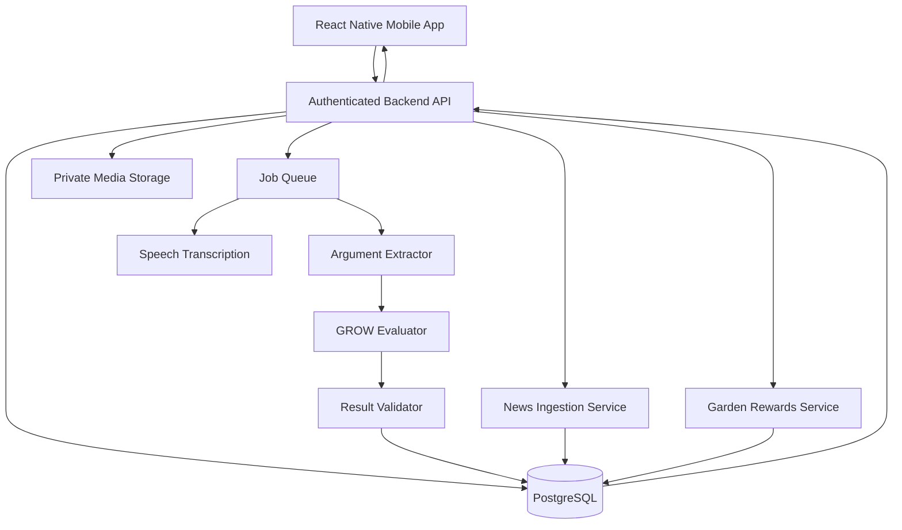

# Grow Your Mind Garden — Product Requirements & Technical Specification

**Version:** 1.0 (MVP build blueprint)
**Platform:** Mobile-first app (iOS and Android)
**Tagline:** *Plant ideas. Grow knowledge. Find your voice.*
**Status:** Proposed architecture and product decisions; refine during implementation.

---

## 1. Aim and Product Vision

### Mission
Build a cozy, gamified AI-powered app that helps users become **more articulate, knowledgeable, and critical thinkers** through short, repeatable practice sessions. Every meaningful practice session contributes to the growth of their virtual **Mind Garden**.

### Problem
People consume information but may struggle to recall it, examine assumptions, form evidence-based viewpoints, or express their ideas spontaneously. Existing speech coaches often emphasize delivery metrics; this product connects knowledge acquisition, reasoning, articulation, and constructive feedback.

### Core value proposition
**Read → Think → Speak/Write → Get Feedback → Retry → Grow.**

The app does **not** reward agreement with the AI or any particular viewpoint. It rewards participation, reflection, evidence-based reasoning, improvement, and consistent practice.

### Target users
- Students preparing for interviews, class discussions, presentations, and debates.
- Young professionals who want to express opinions clearly and think on their feet.
- Curious readers who want to reflect on news instead of passively scrolling.

### Product goals
1. Make five-to-ten-minute intellectual practice sessions enjoyable enough to repeat.
2. Give actionable, evidence-linked feedback rather than generic ratings.
3. Track progress across comparable challenges using transparent evaluation criteria.
4. Create a nurturing, non-punitive game economy through a personal evolving garden.

### MVP success measures (hypotheses; not promises)
- Onboarding completion and first-session completion rates.
- Percentage of users completing a second practice session within seven days.
- Weekly completed attempts, retries, and user-rated usefulness of feedback.
- Human-reviewed change in performance on comparable unfamiliar prompts, rather than AI score improvements alone.
- Error, latency, news-link quality, and transcription correction rates.

---

## 2. Core Features and Scope

| Feature | MVP | Description |
| --- | --- | --- |
| Onboarding & authentication | Yes | Guest preview or account, interests, goals, permissions |
| Home & daily quest | Yes | Personalized entry point with streak, activities and reward status |
| Spin & Speak | Yes | Random prompt, 15-second preparation, 60-second spoken response, AI feedback, retry |
| Debate Garden | Yes (text-first) | A 2–3 round structured debate with an AI challenger, response feedback; speech can be added later |
| Read & Reflect | Yes | Curated articles with source/date/link, reflection prompts, typed or spoken response |
| GROW evaluation | Yes | Dimension-level rubric scores, evidence quotes, uncertainty and improvement tips |
| Mind Garden | Yes | Seed/water/sunlight rewards; plant, water and decorate simple garden plots |
| Growth profile | Yes | Skill trends, attempt history, transcript and feedback review |
| Daily quests & achievements | Yes (basic) | Repeatable quests, streaks and milestones |
| Live debate voice conversation | Later | Real-time interruption and AI speech |
| Community challenges and sharing | Later | Requires moderation, privacy, abuse-prevention design |
| Advanced 3D garden & seasonal events | Later | Start with 2D/isometric garden to control scope |
| Complex factual cross-source verification | Later | MVP verifies against article content and flags uncertain claims |

### App navigation
Bottom tabs: **Home · Play · Discover · Garden · Profile**.

- **Home:** Daily challenge, progress, garden preview, quest cards.
- **Play:** Spin & Speak and Debate Garden.
- **Discover:** News feed and Read & Reflect.
- **Garden:** Interactive plots, planting, watering and decorations.
- **Profile:** History, competency analytics, streaks, achievements, account settings.

---

## 3. Complete User Flow

### 3.1 First-time onboarding
1. User opens the app; sees illustrated seed-to-garden animation and the product value proposition.
2. Chooses **Try as guest** or **Create account**. For persistent analytics and garden synchronization, request an account when appropriate.
3. Selects 2–5 interests (technology, science, society, culture, business, etc.) and a priority goal (articulation, reasoning, knowledge, confidence).
4. Optional 60-second baseline challenge. Label initial results as **starting snapshot**, not a stable measure of ability.
5. Receives a starter seed and enters an empty garden with one plantable plot.
6. Home offers three activities and a clearly marked daily quest.
7. Ask for microphone permission **only when the user taps Record**; allow text input where supported.

### 3.2 Flow A — Spin & Speak
1. **Play → Spin & Speak**.
2. Tap the flower wheel; animate spin and select a server-provided prompt from chosen topics and level. Never rely on animation alone to determine the selected prompt.
3. Show topic and a **15-second prep countdown**; allow optional skip.
4. Begin **60-second recording** with visible countdown, pause/restart/cancel and clear permission handling.
5. Upload audio via secured storage; transcribe and show transcript for correction before evaluation.
6. User submits; evaluation engine grades relevant GROW dimensions plus speech-only delivery.
7. Results show strengths, actionable opportunities, snippets supporting each rating and **one retry challenge**.
8. Retry creates a linked new attempt; compare changes without guaranteeing a score increase.
9. Award a modest completion reward; first completion of a daily quest gives a bonus, never unlimited rewards for replaying identical content.

### 3.3 Flow B — Debate Garden
1. **Play → Debate Garden**; select an issue or generated proposition.
2. Display neutral background context, debate rules, and the proposition.
3. User picks a side or chooses **Surprise me**; explain that users can practice either position without endorsing it.
4. User submits a text argument (MVP); AI offers a relevant, respectful counterargument and one focused question.
5. Repeat for **2–3 rounds**. AI responds to arguments, not personal traits, and must not invent supporting sources.
6. AI summarizes both sides fairly, identifies strong/weak argument structures, and produces GROW feedback.
7. Offer **Revise my opening** or **Try the opposite position**. Award completion rewards.

### 3.4 Flow C — Read & Reflect
1. **Discover** shows a curated news feed with headline, publisher, publication date/time, category and original-source link.
2. Tap an item to view a **licensed excerpt/summary and source attribution**; link to publisher for the full article. Do not scrape or republish paywalled/full copyrighted stories without rights.
3. Read short factual context and clearly distinguish sourced facts from AI-generated questions.
4. Tap **Reflect** and receive 1–3 open-ended prompts: comprehension, evidence/assumptions, and alternative perspectives.
5. User selects **Write** or **Speak**. Speech follows recording → transcription → correction.
6. AI checks answer against the article's available licensed text and flags unsupported claims; it does not automatically mark opinions right or wrong.
7. Show GROW feedback, an optional follow-up question and a **Save to Thought Journal** action.
8. Award completion resources; remember explored topic for future personalized recommendations.

### 3.5 Flow D — Garden and rewards
1. After an activity, reward overlay displays earned **Seeds, Water and Sunlight** and how they were earned.
2. **Garden** shows available plots, inventory and unlocked plants.
3. User plants a seed into an empty plot, spends water to nurture it, and sees growth stages (seed → sprout → bloom).
4. Sunlight and coins (if introduced) unlock cosmetic items only. Do not let rewards or paid items change assessment scores.
5. Garden progresses visually even when users attempt challenging content; scoring and game currency remain separate.

### 3.6 Flow E — Profile analytics
1. **Profile** shows activity totals, streak, unlocked achievements, and recent feedback.
2. A GROW skill chart shows trends by dimension, mode and date range.
3. Tapping a point opens the underlying challenge, corrected transcript, evaluator rationale and retry comparison.
4. Recommendations use recurring areas for practice (e.g. evidence use) and link to activities that develop them.
5. Display **insufficient data** instead of trend claims where samples are too few or tasks are not comparable.

---

## 4. UI / UX Specification

### Visual direction
- **Theme:** Cozy garden simulator meets polished editorial learning app.
- **Mood:** Warm, whimsical, calm, encouraging, not childish or competitive by default.
- **Colors (starting tokens):** Cream `#FFF9ED`, Sage `#A6C8A1`, Forest `#345B48`, Peach `#F5C7A5`, Lilac `#D7C6F4`, Ink `#26352D`.
- **Typography:** Humanist rounded sans for app content; restrained characterful serif for hero titles if readability permits.
- **UI:** Rounded cards, soft shadows, tactile flower buttons, gentle growth transitions, garden character illustrations.
- **Motion:** Flower wheel rotation, seed planting, gentle weather, watering droplets, blooming animations. Provide reduced-motion mode.
- **Accessibility:** Minimum touch targets ~44×44 pt, high contrast, screen reader labels, captions, textual alternatives for animations, clear countdown warnings, support for different accents and speech patterns.

### Screen inventory

| Screen | Primary content | Main action |
| --- | --- | --- |
| Splash / Welcome | Logo, garden illustration, mission | Get started |
| Sign in / Guest | Login methods and guest note | Continue |
| Interest setup | Topic cards, goal selection | Grow my garden |
| Home | Daily quest, streak, skill tip, garden snapshot | Start challenge |
| Play lobby | Two activity cards, recent practice | Choose a mode |
| Spin wheel | Animated petal wheel, category filters | Spin |
| Speech prep | Topic, 15s countdown, tips | Start / skip prep |
| Recording | Audio level, timer, pause/restart | Finish |
| Transcript review | Editable transcript, playback | Evaluate |
| Debate setup | Topic, position, rounds | Start debate |
| Debate chat | AI turns, round progress, input | Send argument |
| Discover feed | Topic chips, article cards, publisher/date | Open article |
| Article details | Source, excerpt/summary, link | Reflect |
| Reflection editor | Question, text/voice switch | Submit |
| Evaluation result | GROW, evidence snippets, improvements | Retry / finish |
| Garden | Garden plots, currency, inventory | Plant / nurture |
| Inventory / Shop | Earned plants and decorations | Place item |
| Profile | Skills, charts, history, badges | View details |
| Attempt detail | Prompt, answer, feedback, comparison | Replay / retry |
| Settings | Permissions, privacy, data export/delete | Manage account |

### Mobile component behaviour
- Bottom navigation always visible on primary pages, hidden during immersive recording/debate.
- One main call-to-action per screen.
- Show loading/skeleton states for articles, transcription and evaluation.
- Evaluation can take time: store a durable processing status and allow return to Home; show in-app result when ready.
- Preserve drafts locally until successfully saved; allow cancellation or retry on network failure.
- Never use red/green to imply that a user's viewpoint is morally correct or incorrect.

### Suggested component library
`GardenHeader`, `QuestCard`, `ActivityCard`, `PetalWheel`, `CountdownTimer`, `AudioRecorder`, `TranscriptEditor`, `DebateTurn`, `ArticleCard`, `ReflectPrompt`, `GrowScoreCard`, `RubricFeedback`, `SkillTrendChart`, `RewardToast`, `GardenPlot`, `PlantSprite`, `InventoryDrawer`, `StreakChip`, `AchievementBadge`.

---

## 5. Assessment Engine — GROW Framework

**Research-informed foundations:** AAC&U VALUE assessment rubrics (critical thinking and communication), Paul–Elder intellectual standards, Toulmin argument structure, Cambridge speaking criteria. **GROW itself is an original proposed product rubric and is not yet psychometrically validated.**

### Dimensions
| Dimension | Meaning | Observable criteria |
| --- | --- | --- |
| **G — Grounded** | Knowledge and evidence | Relevant facts, credible support, source accuracy, appropriate uncertainty |
| **R — Reasoned** | Logic and justification | Clear claim, justified connections, recognition of assumptions and implications |
| **O — Organised** | Clarity and articulation | Coherent sequence, understandable central point, concise explanation |
| **W — Well-rounded** | Nuance and perspectives | Fair alternatives, counterarguments, limitations, distinctions |
| **Delivery** *(audio only)* | Spoken communication | Intelligibility, pacing and audible structure; do not score accent conformity |

### Rubric levels for each criterion
- **1 — Seedling:** Important omissions; little usable reasoning or support.
- **2 — Sprout:** Some relevant material, but noticeable gaps or weak links.
- **3 — Blooming:** Mostly clear, coherent and appropriately supported.
- **4 — Flourishing:** Strong, logically justified and appropriately nuanced for the task.

Define **dimension-specific anchors** and score only evidence actually present. Allow **N/A** if a question is not suited to a dimension; do not invent a score.

### Starting weights (prototypes only)
| Mode | Grounded | Reasoned | Organised | Well-rounded | Delivery |
| --- | ---: | ---: | ---: | ---: | ---: |
| Spin & Speak | 15% | 25% | 40% | 10% | 10% |
| Debate Garden (text) | 20% | 40% | 15% | 25% | N/A |
| Read & Reflect | 35% | 25% | 15% | 25% | N/A |

When Read & Reflect uses voice, show delivery separately rather than changing core thinking scores. For short prompts, certain dimensions may be marked N/A and remaining weights renormalized. Do not compare raw composite scores from different modes as if they measure identical tasks.

### Evaluation output JSON contract
```json
{
  "rubric_version": "grow-v1",
  "attempt_id": "uuid",
  "mode": "spin_speak",
  "language": "en",
  "dimensions": [
    {
      "key": "reasoned",
      "level": 3,
      "confidence": "medium",
      "evidence_spans": [{"start": 32, "end": 92, "quote": "..."}],
      "strength": "Your main reason connects to the claim.",
      "improvement": "Explain why the example supports your conclusion."
    }
  ],
  "overall_score": null,
  "key_takeaway": "Make your reason-to-claim connection explicit.",
  "retry_prompt": "Try again with one clear claim and supporting explanation.",
  "verification_flags": [],
  "needs_review": false
}
```

**Important:** Validate all quotes against the saved transcript. If evidence spans mismatch, discard the fabricated quote and retry or mark evaluation as requiring review. `overall_score` remains optional until scoring is calibrated.

### AI processing flow
1. Fetch authenticated attempt and associated prompt/article snapshot.
2. For audio, obtain transcription and let user correct it.
3. Extract claims, reasons, evidence and counterarguments into structured fields.
4. For article-based tasks, retrieve article excerpts and permitted source metadata; check grounding only where evidence exists.
5. Call a constrained rubric evaluator, requiring dimension-by-dimension anchors and verbatim evidence references.
6. Validate schema, score range, transcript quotes, safety and factual claims.
7. Generate learner-friendly feedback and one specific retry task in a separate coaching step.
8. Save versioned evaluation and update eligible aggregated analytics.
9. Award completion rewards through an **idempotent transaction** independent of the performance rating.

### Guardrails
- Grade argument quality, not agreement with a political or personal stance.
- Do not infer intelligence, demographic traits, emotional condition or truthfulness from voice.
- Don't penalize non-native accents, disability, natural disfluencies or concise wording.
- Distinguish unverified claims from demonstrably incorrect claims.
- Never invent quotes or citations.
- Give users the ability to review and correct transcripts before scoring.
- Provide transparency: methodology, limitations and a way to flag questionable assessments.

### Validation requirements
- Pilot with ~100–200 varied responses as a starting point; obtain independent human rubric ratings.
- Check human-human and AI-human agreement (e.g. weighted kappa or ICC according to scoring design), per dimension.
- Examine robustness to paraphrases, microphone noise, accents and prompt difficulty.
- Track model/prompt/rubric versions to avoid false trends when evaluator changes.
- Show longitudinal skill trends only when task comparability and sample count justify them.

---

## 6. Technical Architecture

### Recommended MVP stack
| Layer | Recommendation | Rationale |
| --- | --- | --- |
| Mobile app | **React Native + Expo + TypeScript** | One codebase for iOS/Android, rapid iteration |
| Navigation/UI | Expo Router + reusable themed components | Organized route structure |
| State/data fetching | TanStack Query + small local state store | Server-state caching and simple UI state |
| Backend/API | **Supabase** (PostgreSQL, Auth, Storage, Edge Functions) | Fast MVP with managed services |
| Background processing | Managed queue/worker compatible with hosting provider | Durable asynchronous transcription/evaluation jobs |
| AI orchestration | Server-side model gateway with structured JSON outputs | Key protection, moderation, versioned evaluations |
| Speech recognition | Server-side speech-to-text provider | Consistent transcription for short recordings |
| Analytics visualizations | Mobile-native chart library | Responsive GROW charts |
| News ingestion | Licensed news API, publishers' permitted RSS feeds, or manually curated links | Attribution and copyright compliance |
| Error observability | Error monitoring + structured server logs | Debug processing failures and latency |

**Architecture note:** Provider choices are replaceable; verify SDK/API support, costs, licensing and current documentation before implementation. Never embed model or news API keys in the client app.

### Logical system diagram


### API/security principles
- Authenticated access for profile, recordings, garden and feedback.
- Database row-level security so users only access their own attempts and gardens.
- Private audio blobs with expiring signed URLs; delete on user request.
- Rate limits, maximum recording/file size and token-cost budgets per user/session.
- Validate structured AI responses server-side; reject malformed evaluation output.
- Store article source URI, publication timestamp, ingestion time, attribution/license and content snapshot/hash.
- Sanitize article content and treat it as untrusted input (prompt-injection resistance).
- Record consent and implement data retention/deletion controls.
- Use a server transaction for score save + idempotent reward granting.
- Avoid exposing other users' attempts via analytics or leaderboard endpoints.

---

## 7. Database Design (Initial Relational Schema)

### Identity and preferences
- **profiles**: `id (auth user UUID PK)`, `display_name`, `avatar_url`, `created_at`, `timezone`, `onboarding_complete`
- **user_preferences**: `user_id PK/FK`, `interests JSONB`, `learning_goals JSONB`, `preferred_language`, `notifications_enabled`

### Activity content
- **topics**: `id`, `title`, `category`, `difficulty`, `is_active`
- **prompts**: `id`, `topic_id`, `mode`, `question`, `context`, `difficulty`, `created_at`, `source_type`
- **articles**: `id`, `title`, `source_name`, `source_url`, `published_at`, `ingested_at`, `category`, `image_url`, `excerpt`, `summary`, `license_status`, `content_hash`
- **reflection_questions**: `id`, `article_id`, `question_type`, `question`, `generation_version`

### Practice and evaluation
- **sessions**: `id`, `user_id`, `mode`, `prompt_id NULL`, `article_id NULL`, `status`, `started_at`, `completed_at`
- **attempts**: `id`, `session_id`, `user_id`, `round_index`, `response_type`, `text_answer`, `audio_storage_path`, `transcript`, `transcript_edited`, `duration_seconds`, `retry_of_attempt_id`, `status`, `created_at`
- **debate_turns**: `id`, `session_id`, `turn_no`, `speaker (user/ai)`, `message`, `related_attempt_id`, `created_at`
- **evaluations**: `id`, `attempt_id UNIQUE`, `rubric_version`, `model_version`, `prompt_template_version`, `scores_jsonb`, `feedback_jsonb`, `verification_flags JSONB`, `status`, `created_at`
- **evaluation_jobs**: `id`, `attempt_id`, `job_type`, `status`, `idempotency_key UNIQUE`, `retry_count`, `last_error`, `created_at`, `updated_at`
- **thought_journal_entries**: `id`, `user_id`, `article_id NULL`, `session_id NULL`, `body`, `created_at`

### Garden and progression
- **gardens**: `id`, `user_id UNIQUE`, `level`, `experience_points`, `layout_jsonb`, `created_at`
- **resource_wallets**: `user_id PK`, `seed_balance`, `water_balance`, `sunlight_balance`
- **plant_catalog**: `id`, `name`, `plant_type`, `growth_stages`, `asset_key`, `unlock_level`, `cost_jsonb`
- **garden_items**: `id`, `garden_id`, `catalog_item_id`, `plot_id`, `growth_stage`, `planted_at`, `last_watered_at`, `position_jsonb`
- **reward_ledger**: `id`, `user_id`, `source_type`, `source_id`, `reward_type`, `amount`, `idempotency_key UNIQUE`, `created_at`
- **quests**: `id`, `quest_type`, `title`, `rules_jsonb`, `reward_jsonb`, `active_from`, `active_until`
- **user_quest_progress**: `user_id`, `quest_id`, `progress`, `completed_at`, `claimed_at`
- **achievements**: `id`, `title`, `criteria_jsonb`, `icon_asset`
- **user_achievements**: `user_id`, `achievement_id`, `unlocked_at`

### Analytics and operations
- **analytics_events**: `id`, `user_id`, `event_name`, `properties JSONB`, `timestamp` (respect consent and privacy)
- **user_skill_snapshots**: `id`, `user_id`, `mode`, `dimension`, `rubric_version`, `sample_count`, `score_summary`, `period_start`, `period_end`
- **user_reports**: `id`, `user_id`, `target_type`, `target_id`, `reason`, `created_at`, `status`

**Important relationships:** `profiles → sessions → attempts → evaluations`; `sessions → debate_turns`; `profiles → gardens → garden_items`; `profiles → reward_ledger`.

Create migrations, foreign keys, indexes for `user_id`, `(mode, created_at)`, article publication dates, and strict authorization policies.

---

## 8. Backend Endpoints / Server Functions

| Method / route | Purpose |
| --- | --- |
| `GET /api/home` | Aggregated daily quest, wallet, garden preview, recommended practice |
| `GET /api/prompts?mode=...&topic=...` | Eligible prompts and difficulty |
| `POST /api/sessions` | Create session with server-selected prompt/topic |
| `POST /api/attempts` | Save typed response or initiate signed audio upload |
| `POST /api/attempts/:id/transcribe` | Queue transcription and return job ID |
| `PATCH /api/attempts/:id/transcript` | Correct transcript before evaluation |
| `POST /api/attempts/:id/evaluate` | Queue GROW evaluation (idempotent) |
| `GET /api/jobs/:id` | Poll job state/result reference |
| `GET /api/attempts/:id/feedback` | Load evaluation, quotes and retry prompt |
| `POST /api/debates/:sessionId/turn` | Submit turn and get next AI counterargument |
| `GET /api/articles` | Curated feed with attribution and filter fields |
| `GET /api/articles/:id` | Licensed article content and reflection questions |
| `POST /api/journal` | Save user's personal reflection |
| `GET /api/garden` | Plots, inventory, resource wallet |
| `POST /api/garden/plant` | Plant item in available plot via transaction |
| `POST /api/garden/water` | Spend water and advance eligible growth |
| `GET /api/profile/analytics` | Mode-filtered skill trends and attempt history |
| `GET /api/quests` | Current quests and completion state |
| `DELETE /api/account` | Delete or queue deletion of profile and personal data |

### Example background job state
`queued → processing → completed | failed`; include bounded retry logic and status polling. Do not double-grant rewards after retrying a network call.

---

## 9. News Content Pipeline

1. Ingest from sources permitting the intended use; do not use unlicensed full-article scraping.
2. Normalize title, publisher, timestamp, source URL, image rights, category and permitted excerpt.
3. Deduplicate links and store provenance plus content hashes.
4. Use server-side AI to generate a *clearly labeled summary* only from permitted input; retain source associations.
5. Generate reflective questions of increasing depth: **Understand**, **Examine**, **Consider another view**.
6. Editorially filter misinformation, sensationalism, unsafe content and near-duplicate stories; include diverse trustworthy perspectives where appropriate.
7. Link to original reporting and never present AI-generated summaries as original journalism.
8. If an article is unavailable/blocked, still show its metadata and direct users to the original link; do not fabricate content.

---

## 10. Reward Economy and Retention

### Rewards
- **Seeds:** Earned for first completion of a practice activity.
- **Water:** Earned for maintaining a manageable daily learning routine.
- **Sunlight:** Earned for trying a feedback-based retry or engaging thoughtfully with an alternative perspective (not for agreement).
- **XP:** Unlock garden areas, plant varieties, aesthetic themes and achievement titles.

### Suggested quests
- *Morning Bloom:* Complete one Spin & Speak.
- *Deep Roots:* Explain a piece of evidence in a debate.
- *Curious Reader:* Reflect on one news story.
- *Second Bloom:* Retry a challenge using the AI's specific feedback.

### Anti-gaming rules
- Award meaningful completion rewards once per eligible attempt/session.
- Cap repeatable currency rewards per day, without capping legitimate learning.
- Let users earn rewards for effort even when their rubric rating is low.
- Support streak recovery; avoid guilt-based copy or manipulative notifications.
- No leaderboard that ranks ideological positions or perceived intelligence.

---

## 11. MVP Build Plan

### Milestone 1 — App foundation
- Create Expo project and design tokens.
- Build navigation, auth/guest support, onboarding, profiles and PostgreSQL policies.
- Create reusable garden-themed components and loading/error states.

### Milestone 2 — End-to-end Spin & Speak
- Prompt catalogue and server-side wheel selection.
- Audio recording, signed upload, transcription, transcript correction.
- Structured GROW evaluator and results/retry screen.
- Persist attempts and evaluator versions.

### Milestone 3 — Read & Reflect
- Integrate legally usable article metadata and permitted content.
- Build Discover feed, article details, reflection prompts, type/speak responses.
- Apply source-grounded scoring and save Thought Journal entries.

### Milestone 4 — Debate Garden
- Structured turn-based AI counterarguments and 2–3 round state machine.
- Conversation persistence, timeout/retry handling, summaries and evaluations.

### Milestone 5 — Garden and Profile
- Reward ledger, plots, initial plant sprites, resource wallet, quests, achievements.
- Build performance graphs, history, trends and tailored recommendations.

### Milestone 6 — QA, safety and beta
- Validate privacy, row security, deletion, moderation, source rights and offline/network handling.
- Conduct human evaluation benchmark and calibration study.
- Test accessibility and accent/noise robustness.
- Run a small user pilot and revise rubrics, onboarding and retention loops.

**Release criterion:** A new user can onboard, complete each of the three modes, receive transparent feedback, grow at least one plant, and inspect the saved session in Profile without data loss.

---

## 12. Suggested Repository Structure

```text
grow-your-mind-garden/
├── app/                         # Expo Router screens
│   ├── (auth)/
│   ├── (tabs)/
│   │   ├── index.tsx            # Home
│   │   ├── play.tsx
│   │   ├── discover.tsx
│   │   ├── garden.tsx
│   │   └── profile.tsx
│   ├── spin/
│   ├── debate/
│   ├── article/
│   ├── evaluation/
│   └── settings/
├── components/
│   ├── garden/
│   ├── activities/
│   ├── evaluation/
│   └── common/
├── features/
│   ├── onboarding/
│   ├── practice/
│   ├── debate/
│   ├── news/
│   ├── garden/
│   └── analytics/
├── lib/
│   ├── api/
│   ├── auth/
│   ├── audio/
│   ├── theme/
│   └── validation/
├── assets/
│   ├── plants/
│   ├── garden/
│   └── icons/
├── supabase/
│   ├── migrations/
│   ├── functions/
│   └── seed.sql
├── docs/
│   ├── grow-rubric.md
│   ├── content-policy.md
│   └── test-plan.md
└── README.md
```

---

## 13. Product Acceptance Criteria

- [ ] User can finish onboarding and return to the same garden on another device when logged in.
- [ ] Wheel prompt always matches the server's selected challenge.
- [ ] Audio recording can be canceled, replayed and corrected through transcript review.
- [ ] Every evaluation provides rubric level, actual cited answer evidence, and one actionable recommendation.
- [ ] Failing an AI request never silently loses a submitted response.
- [ ] Debate AI offers an on-topic, respectful challenge rather than automatic agreement.
- [ ] News cards cite a publisher and date and provide a working source URL.
- [ ] User can answer reflections by typing or speaking.
- [ ] Garden transactions are atomic; duplicate submissions do not produce duplicate rewards.
- [ ] Profile graphs distinguish modes and indicate insufficient comparable data.
- [ ] User can access, export where supported, and delete personal practice data.
- [ ] Secrets and model requests are server-side; storage and database access are authenticated.
- [ ] Screens support accessibility, loading, failure, and reduced-motion behaviour.

---

## 14. Future Opportunities (Post-MVP)

- True live voice debate with interruption handling and real-time turn-taking.
- Knowledge graph and spaced-repetition of users' own arguments and articles.
- Optional real-life speaking missions and user reflection.
- Collaborative clubs, moderated discussion circles and weekly community prompts.
- Expanded garden biomes, dynamic seasons and richer animations.
- Evidence library showing links between topics, arguments and sources.
- Offline prepared activities and multilingual support.
- Educator mode with privacy-preserving cohort progress (only with permission).

---

## 15. First Implementation Task

**Build a vertical slice before adding more game mechanics:** onboarding → Spin & Speak prompt → audio → transcript → GROW feedback → one reward → plant a seed → see the session in Profile.

This validates the full value loop and backend data flow. Once stable, reuse the same session, attempt, evaluation and reward infrastructure for Debate Garden and Read & Reflect.

### Research foundations / reference reading
- AAC&U VALUE Rubrics: https://www.aacu.org/initiatives/value-initiative/value-rubrics
- Foundation for Critical Thinking, intellectual standards: https://www.criticalthinking.org/pages/universal-intellectual-standards/527
- Purdue OWL, Toulmin argument: https://owl.purdue.edu/owl/general_writing/academic_writing/historical_perspectives_on_argumentation/toulmin_argument.html
- Cambridge English assessment: https://www.cambridgeenglish.org/
- OECD PISA reading literacy: https://www.oecd.org/pisa/

*This document is a practical starting specification. API services, source licensing, scoring weights, cost budgets and privacy compliance require verification before production release.*
