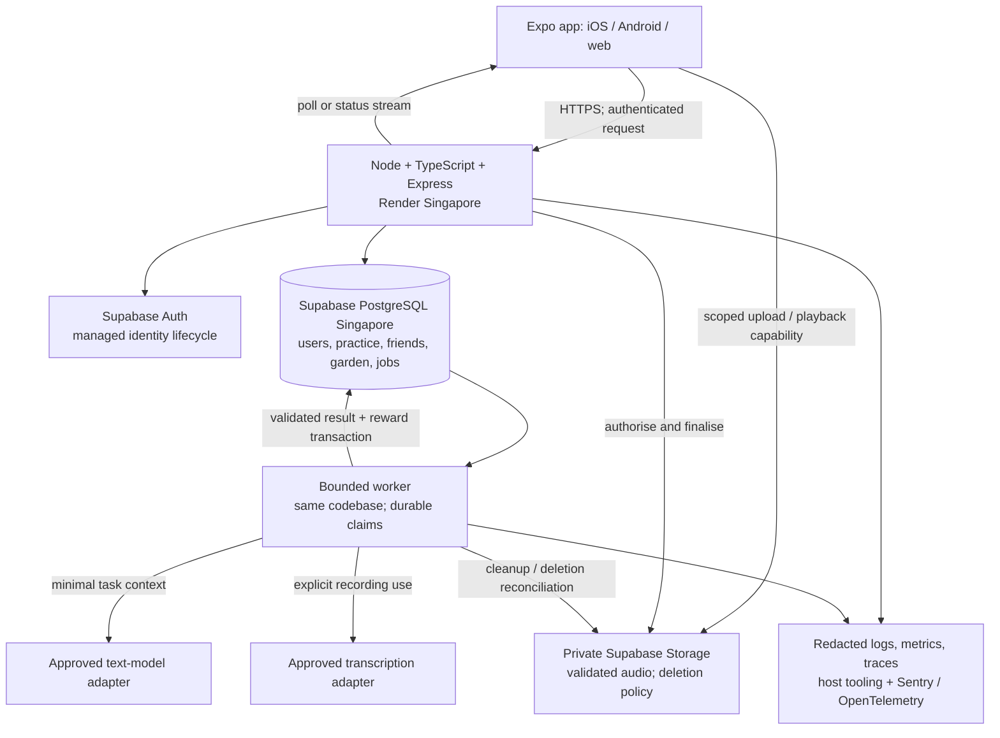

# BridgingMinds — Technical architecture and AI model review

**Decision date: 1 November 2026, Singapore · Status: recommendations evaluated; implementation not started**

## Executive decision

**Refactor incrementally, retaining the current Expo/React Native client and Express application.** Adopt TypeScript across the backend, managed PostgreSQL/Auth/private storage through Supabase in Singapore, and an always-on Node service on Render in Singapore. Preserve the existing product, guest experience, practice modes, optional reflection/guidance, friend debates, garden and saved work.

Use **deterministic application controls plus one LLM call per language task**, with a separate transcription model. Keep `gpt-6-luna` and `gpt-transcribe` as the implementation baseline. Benchmark Luna against `gpt-6.1-terra`, `claude-haiku-5-5` and Gemini before changing the production model. Prefer Terra as the first same-provider fallback candidate after validation; an independent-provider fallback requires its own quality and privacy approval. No model has won a BridgingMinds benchmark in this review.

The immediate problems are operational and evidentiary: reliable deletion, upload admission, job ownership/concurrency, account recovery, bounded history queries, production configuration, and a real model-quality benchmark. Replacing the UI framework would not fix them.

The modeled monthly operating floor is approximately **US$72 / $78 / $112 / $161 / $1,050** for **30 / 100 / 500 / 1,000 / 10,000 monthly active users**, respectively, under the workload in section 14. A provisioned 10,000-user scenario with more compute, monitoring and point-in-time recovery is about **$1,253/month**. These are price-based scenarios, not measured capacity or a hosting quote. Native distribution and labour are separated below.

### Scope and confidence

This review inspected source, manifests, schemas, tests and documentation; checked official vendor documentation/pricing; ran local isolated backend tests, lint, typecheck and a dependency audit. It did not read credentials, active user records or recordings, run paid model requests, inspect cloud accounts, deploy, or change application code. Product direction and audience are unchanged.

Evidence labels used throughout: **observed** means current source or a completed local check; **published** means a vendor's documented specification/offer; **estimated** means arithmetic or planning assumptions; **proposed** means a decision or experiment not yet implemented. Public specs do not establish output quality, Singapore latency, account entitlement or legal compliance.

Detailed evidence: [repository audit](repository-audit.md), [stack and infrastructure](stack-infrastructure.md), [AI models](ai-models.md), [benchmark and prompt specification](benchmark-design.md), [decision records](decisions.md).

## 1. Existing architecture audit

| Component | Current implementation | Strengths | Weaknesses | Keep / Refactor / Replace |
| --- | --- | --- | --- | --- |
| Frontend | Expo 57, React Native 0.86, React 19, TypeScript, Expo Router, SVG/Reanimated, Expo Audio; web export | Existing mobile/web product, shared components, reduced-motion and alternative garden controls | Large screen components; native release/audio/accessibility still need device verification | **Keep; refactor** state and screen boundaries |
| Client state/API | React context, typed interfaces, fetch/Expo fetch, account-scoped AsyncStorage drafts, SecureStore native token | Protects against stale responses after account switching; preserves drafts | Broad state refresh; `api<T=any>` permits weak contracts; drafts are not encrypted content storage | **Refactor** bounded queries and shared runtime contracts |
| Backend | Node 24+, Express 5, JavaScript ESM; API plus static export | Straightforward, testable, useful ownership/domain logic | `server/app.mjs` is 2,142 lines; synchronous crypto/files/SQLite; HTTP and domain logic intertwined | **Keep Express; incrementally type and split modules** |
| Database | Node SQLite, WAL, foreign keys, indexes; relational ownership plus JSON records | Transactions and unique keys protect rewards, garden spending and friend turns | No versioned migration runner; unbounded history reads; not configured for multiple writers/hosts | **Keep for local use; replace production store with PostgreSQL** |
| Authentication | Custom guests/email-password, salted scrypt, hashed 30-day sessions; HttpOnly web cookie/native SecureStore | Meaningful existing security controls | No recovery/verification; guest upgrade leaves old sessions valid; no recent-auth deletion gate | **Replace credential lifecycle with managed Auth**, preserve domain identity |
| AI provider | Fixed OpenAI endpoints, explicit model allowlist, no automatic retry; Luna + `gpt-transcribe` defaults | Sanitised failures, timeout, server-only secrets, offline fixtures | Single provider, no usage/latency accounting; model-name parameter heuristic | **Keep boundary; refactor explicit capabilities and telemetry** |
| Assessment | Shared mode rubrics, strict schema, exact quotes, N/A/provenance rules | Defends data integrity; does not claim validated ability | Semantic interpretation and ratings are unvalidated; no comparative model dataset | **Keep controls; benchmark before model selection** |
| Guided draft/debate | Optional annotated draft with cache/deduplication; solo debate reply | Original response retained; explicit draft action | Draft always requires prose/2–5 annotations; debate lacks explicit refusal/finish checks | **Refactor narrow contracts and recovery** |
| Background jobs | Durable SQLite evaluation rows; local timers/sets | Saved work and restart recovery | No durable lease/global concurrency; startup requeues all processing jobs | **Refactor before overlapping instances** |
| Audio | Private local files, consent, ownership, signed playback, 30-day access expiry | Not publicly served; shared friend audio is access-controlled | Physical cleanup is opportunistic; deletion can orphan files; MIME/duration not verified | **Replace production storage; retain and strengthen access rules** |
| News | Fixed CNA/NPR/NASA RSS, bounded parser and cache | No arbitrary URL fetching; source/timezone controls | Rights remain personal/noncommercial for restricted feeds; per-process cache | **Keep technically; resolve commercial permission** |
| Deployment/operations | Local server and static export; no project CI/deployment/restore automation found | Reproducible local commands | Hosting/TLS/backups/alerts unverified; current Git root is the user's home directory | **Add a project-only release boundary and production config** |
| Testing | 149 backend tests; Chrome Playwright suites; mock-provider integration; offline rating benchmark | Broad recovery, ownership, economic and schema contracts | No fresh full browser/native/load/penetration/human-quality result in this review | **Keep and extend** |

Source anchors: [package](../../../package.json), [API](../../../server/app.mjs), [database](../../../server/database.mjs), [provider](../../../server/provider.mjs), [client API](../../../src/lib/api.ts), [state](../../../src/lib/state.tsx). Precise findings and test references are in the [audit](repository-audit.md).

## 2. Technical weaknesses and risks

### Release priorities grounded in code

1. **Deletion durability:** audio rows are cascaded away before file unlink; failure after commit can strand files. Expired untouched audio can remain beyond 30 days on a long-running service. Add durable deletion tombstones, scheduled cleanup, retries, reconciliation and deletion-lag alarms. [Deletion](../../../server/app.mjs:2066), [startup cleanup](../../../server/app.mjs:2115)
2. **Upload admission:** up to 10 MB is buffered before authentication; declared MIME/byte limits do not establish valid audio or duration. Authenticate first; stream/quarantine, verify container/duration, and enforce account/service quotas. [Middleware](../../../server/app.mjs:597), [upload](../../../server/app.mjs:1359)
3. **Duplicate paid work:** process-local sets and unconditional restart requeueing cannot safely coordinate rolling overlap. Add database claims, leases, conditional completion and bounded concurrency. Exactly-once rewards do not mean exactly-once provider billing. [Worker](../../../server/app.mjs:1075), [recovery](../../../server/app.mjs:2109)
4. **Identity lifecycle:** managed recovery/verification, session rotation on guest upgrade, revoke-all and recent reauthentication are needed. Preserve current owner checks. [Auth](../../../server/app.mjs:625)
5. **Unbounded reads:** `/state` loads the learner's full attempt/history data, and multiple garden/job actions refresh it. Separate compact current state from paginated history; index request keys instead of scanning JSON. PostgreSQL alone does not fix this. [State](../../../server/app.mjs:469)
6. **Operational limits:** rate limits reset with the process; there is no persisted monetary budget or real provider-usage ledger. Configure trusted-proxy handling for the selected host, shared quotas and alerting. [Limits](../../../server/app.mjs:256)
7. **Source/build boundary:** `git rev-parse --show-toplevel` resolves to `/Users/oliviachew`. Establish a dedicated repository or explicitly isolated project build context before CI. Never build, stage or publish the entire home directory.

The dependency audit found **17 affected packages: 6 high, 9 moderate, 2 low, 0 critical**. This includes transitive Expo tooling and a Router decoding path; it is not 17 independent, proven-exploitable backend vulnerabilities. Direct backend Zod is 4.6.7; the flagged older copy is in Expo CLI. Resolve supported dependency paths without `npm audit fix --force` or an unreviewed SDK downgrade. No fixes were applied in this review.

No cloud-account evidence was available for actual encryption, access controls, backups, billing limits, domain/TLS configuration or data-processing contracts. Their absence in source is a deployment verification gap, not proof that an external host is insecure. Dated documentation also differs on prior live-provider checks; this review did not verify current account access.

## 3. Frontend framework comparison

React is the component foundation used by both React Native and Next.js, rather than a direct replacement for either.

| Option | Fit for this product | Development, performance and accessibility trade-off | Decision |
| --- | --- | --- | --- |
| **Expo / React Native / Router** | Existing phone-first recording, gestures, private drafts and shared web/native app | Maximum reuse. Native audio, background/foreground behaviour, touch and assistive technology need device testing. Web semantics need deliberate attention. | **Preferred** |
| Next.js / React web | Strong if browser-only delivery, SSR or public indexed content were the primary requirement | Would still need a separate native client or a changed distribution strategy; does not inherently improve LLM latency. Adds migration of working screens without an established product benefit. | Do not replace the app; reconsider only for a separately justified web surface |
| React web SPA | Adequate browser application with simpler web conventions | Loses native component reuse; current Expo export already serves the web use case. | No migration benefit established |
| Flutter | Capable shared mobile UI with its own rendering/tooling | Requires Dart and a UI/navigation/audio/test rewrite; quality would depend on execution, not framework branding. No measured bottleneck warrants that cost. | Reject for this rebuild |

Keep Expo Router, split the 2,534-line Practice and 1,428-line Garden screens by state/domain boundaries, and retain familiar components. Introduce narrow server-state hooks and shared request/response schemas; add a query-cache library only if measured invalidation complexity warrants it. Preserve reduced motion, keyboard alternatives, text scaling and screen-reader labels. Measure startup, render/JS-thread work and gesture responsiveness on low-end devices before optimising individual components.

Expo 57 documentation and current routing/native guidance were checked; new Expo dependencies must use the SDK-compatible install workflow. Streaming must be verified with the selected Expo/native fetch path, not assumed to behave like desktop EventSource. [SDK 57](https://docs.expo.dev/versions/v57.0.0/), [Expo documentation index](https://docs.expo.dev/llms.txt), [stack comparison](stack-infrastructure.md)

## 4. Backend framework comparison

| Option | Advantages for BridgingMinds | Costs / limits | Decision |
| --- | --- | --- | --- |
| **Node + TypeScript + Express 5** | Reuses working code, shared schema/domain types and I/O-oriented provider flow; one language across client/server | Must replace sync hot-path work, add contracts and structure; TypeScript does not validate network input by itself | **Preferred** |
| Node + Fastify | Useful schema/plugin conventions and an alternative HTTP implementation | Framework rewrite is unlikely to dominate end-to-end model latency; existing contracts already use Express/Zod | Reconsider only after profiling or a clear maintainability problem |
| Python + FastAPI | Strong for Python-centric ML/data workloads, async APIs and typed validation | Second language/runtime and duplicated shared contracts; current app calls hosted models rather than running Python ML | Not justified now; add a bounded service only if a real Python-only workload appears |
| Per-route serverless functions | Convenient stateless endpoints and burst scaling | Existing durable work cannot rely on post-response timers or local files; fragmented auth/jobs and cold-start behaviour add migration work | Not the initial backend shape |

Use a **modular monolith**, with identity, practice, assessment, media, friends, garden/economy and news modules. Keep transport adapters and persistence repositories separate from domain rules. Start with the same deployment artifact running API and a bounded worker; split worker deployment only when isolation/capacity warrants it. Keep Node's built-in test runner rather than replacing working tests for a fashionable test framework.

## 5. Database and authentication comparison

| Option | Relevant strengths | Trade-offs | Decision |
| --- | --- | --- | --- |
| **Supabase PostgreSQL + Auth + private Storage** | Relational constraints/transactions fit rewards, memberships, ordered turns and jobs; managed recovery/verification/storage; Singapore region and backups | Auth integration/ID migration still require care; service-role access bypasses RLS; compute/disk/egress are separate charges | **Preferred production platform** |
| Managed PostgreSQL + separate Auth/object storage | Portability and separate vendor selection | More contracts, credentials, integrations and billing for a small team | Viable if requirements outgrow the integrated platform |
| Firebase Auth + Firestore/Storage | Managed identity, client ecosystem, realtime/offline workflows | Current relational/transactional design would need document/read-model redesign; operation-based billing requires a different usage model | Reject for migration cost and data fit, not because it cannot scale |
| SQLite on persistent host | Low cost, existing tests and simple local operation | Single-host ownership, backups and disaster recovery remain the team's responsibility; current worker/limits are process-bound | Keep for local development; a restricted pilot is possible after P0 fixes, not the preferred public architecture |

Promote user ownership, status, timestamps, request keys, lease fields and queried IDs to typed/indexed PostgreSQL columns. Preserve immutable source snapshots, assessment payloads, annotation text and drawings as versioned JSONB where appropriate. Retain foreign keys, unique reward keys and room-turn constraints; do not merely copy JSON and lose invariants.

Keep a stable application user ID with a unique mapping to the managed-auth subject. Browser authentication should stay behind a same-origin backend with HttpOnly, Secure cookies and controlled refresh; do not silently replace this with persistent browser-readable bearer tokens. Native credentials belong in SecureStore with tested refresh/revocation. An HttpOnly-only backend flow is an intentional integration design, not a claim that every default Supabase browser integration provides it.

All sensitive mutations remain server-authorised. Use least-privilege database roles and explicit user-scoped queries; apply RLS to any exposed data/storage surfaces and test it. A Supabase service key must never enter the client, and service-role bypass means RLS cannot compensate for a missing server owner check. Account deletion must span Auth, domain data, objects and deletion tombstones.

Supabase Pro includes 100,000 MAU, a base database/storage allowance and daily database backups; compute and overages still matter. Database backups do not include the actual Storage objects. Default email delivery is not suitable for production recovery; configure a real SMTP provider. [Supabase pricing](https://supabase.com/pricing), [compute sizing](https://supabase.com/docs/guides/platform/compute-and-disk), [infrastructure evidence](stack-infrastructure.md)

## 6. Hosting and deployment comparison

| Provider | Fit | Main trade-off | Decision |
| --- | --- | --- | --- |
| **Render Singapore, paid always-on Node** | Keeps existing long-lived Express/worker semantics; simple service deployment and logs | Fixed monthly compute; bounded regional choice and egress; team/autoscaling plans cost more | **Preferred initially** |
| Google Cloud Run, Singapore | Portable containers, autoscaling and granular billing | Work after HTTP response needs a deliberate service/job/task design; scale-to-zero and minimum/always-allocated CPU change cost and recovery | Strong alternative if cloud operations and explicit task delivery are acceptable |
| Vercel | Excellent deployment workflow for web/functions; Pro has published usage/CDN allowances | No benefit from moving this mobile client to Next.js merely to host it; existing persistent worker/files require redesign | Reasonable for a future separate web surface, not preferred backend migration |
| AWS ECS/Fargate or Lambda | Broad regional/security/services options | More IAM/networking/deployment/billing choices; ALB and surrounding resources contribute cost | Use when institutional requirements or team expertise justify it |
| Cloudflare Workers + storage | Distributed stateless API/static delivery and usage-based pricing | Current Node SQLite/filesystem/worker assumptions are not a drop-in match; D1 is not PostgreSQL | Possible edge/static layer later; do not rewrite the backend to obtain it |

AWS App Runner is closed to new customers as of 30 April 2026, so it is not a new-deployment recommendation. AWS points new workloads toward ECS Express Mode. [AWS notice](https://docs.aws.amazon.com/apprunner/latest/dg/apprunner-availability-change.html)

Start with one paid Render 1 CPU/2 GB service, not the free sleeping service, and one Supabase production project. Serve the exported web application and API under one origin initially. Use a project-only Git/build context, pinned lockfile/runtime, environment-separated secrets, health/readiness checks and controlled rollout. A paid service on the solo Hobby workspace avoids unnecessary team-plan expense; add Pro when collaboration or scaling features require it. Do not assume zero-downtime overlap is safe before job leases exist. [Render pricing](https://render.com/pricing), [Vercel Pro](https://vercel.com/docs/plans/pro-plan), [Cloud Run pricing](https://cloud.google.com/run/pricing)

This is managed infrastructure around a traditional long-lived application. It does not need Kubernetes, multiple domain microservices, a vector database or a separate agent platform.

## 7. AI model comparison matrix

**Published prices below are USD per million input/output tokens for standard short-context requests, checked 1 November 2026.** They exclude cache writes/storage, extra reasoning, tax and region premiums. They are not quality scores. Context capacity is not context effectiveness.

| Exact API model | Input / output | Published context / output ceiling | Structured output / integration | Recommended role |
| --- | ---: | --- | --- | --- |
| `gpt-6-luna` | $0.10 / $0.50 | 1.05M / 128K | Strict schema, streaming; existing adapter/profile | **Baseline primary, conditional on benchmark**. [Spec](https://developers.openai.com/api/docs/models/gpt-6-luna) |
| `gpt-6.1-terra` | $1 / $5 | 1.05M / 128K | Schema/streaming; explicit new parameter profile required | First stronger candidate/fallback to test. [Spec](https://developers.openai.com/api/docs/models/gpt-6.1-terra) |
| `gpt-6.1-sol` | $2 / $10 | 1.05M / 128K | Reasoning required; current `none`/temperature approach cannot simply be reused | Higher-cost quality reference. [Spec](https://developers.openai.com/api/docs/models/gpt-6.1-sol) |
| `claude-haiku-5-5` | $0.10 / $0.50 at ≤100K input | 1M / 128K | Native Messages/schema adapter; omit unsupported sampling controls | Independent-provider challenger; same nominal price does not imply equal quality. [Pricing](https://platform.claude.com/docs/en/about-claude/pricing), [spec](https://platform.claude.com/docs/en/models/haiku-5-5/overview) |
| `claude-sonnet-5-5` | $2 / $10 | 1M / 128K | Native schema/streaming integration | Higher-cost quality reference. [Spec](https://platform.claude.com/docs/en/models/sonnet-5-5/overview) |
| `gemini-3.5-flash-lite` | $0.30 / $2.50 | 1,048,576 input / 65,536 output | Schema subset; keep application limits and provider-native handling | First Google challenger. [Spec](https://ai.google.dev/gemini-api/docs/models/gemini-3.5-flash-lite), [pricing](https://ai.google.dev/gemini-api/docs/pricing) |
| `gemini-3.8-flash` | $0.75 / $3.75 promotional | 1,048,576 input / 65,536 output | Streaming/schema; lowest supported thinking level is `low` | Secondary challenger; rates double 1 January 2027. [Spec](https://ai.google.dev/gemini-api/docs/models/gemini-3.8-flash) |
| Together `openai/gpt-oss-120b` | $0.15 / $0.60 | 131,072 context; hosted output cap not verified | Hosted open-weight, compatible interface/schema; confirm exact model controls | Open-weight comparison; no GPU hosting now. [Catalogue](https://docs.together.ai/docs/serverless/models) |
| Together `deepseek-ai/DeepSeek-V4.1-Flash-1017` | $0.30 / $1.20 | 1M context; hosted output cap not verified | Different reasoning parameter semantics | Optional open-weight challenger. [Spec](https://www.together.ai/models/deepseek-v4-1-flash-1017) |

The [full model matrix](ai-models.md) also records cache prices, current flagship options, retirement dates, provider policies, STT alternatives and unresolved specifications. Newest flagship models were considered but are not defaults: their published capabilities do not establish a benefit for a short, constrained response task.

### How the twelve evaluation dimensions affect selection

- **Quality, meaning preservation, instruction following, safety and local language handling:** unknown comparatively for BridgingMinds. Test exact tasks and language slices; generic benchmarks or language lists cannot establish them.
- **Latency:** no measured Singapore p50/p95 or time-to-first-token result exists here. Streaming support is documented, not a latency guarantee. Measure cold/warm schemas and realistic concurrency.
- **Cost:** verified rates support the estimates; tokenizer, thinking, failed calls and retries can change actual cost per accepted output.
- **Structured output:** all shortlisted families have documented mechanisms, but schema dialects, bound enforcement, refusal and finish handling differ. Keep application validation for every provider.
- **Context:** the current bounded task context is far below model windows. Do not append the entire learner history simply because a model permits it.
- **Privacy:** global endpoints are not Singapore processing guarantees. Direct OpenAI Singapore residency currently distinguishes storage from inference; Anthropic's technical and commercial retention descriptions conflict; Google paid and free terms differ; hosted open-weight defaults also need configuration. See section 13 and the sourced [provider policy table](ai-models.md).
- **Reliability and integration:** public capability tables do not verify account quotas, uptime under this workload or access. Existing OpenAI integration reduces migration risk; alternate providers require contract/streaming/error tests and approved data flows.

Keep `gpt-transcribe` as the STT baseline at **$0.0045 per audio minute**. Compare Google/Deepgram only if measured correction burden or language failures justify it. Transcription is separate from pronunciation assessment; no current model swap creates validated mispronunciation detection. [STT spec](https://developers.openai.com/api/docs/models/gpt-transcribe)

## 8. Proposed AI evaluation benchmark

The existing offline benchmark reports ordinal rating agreement; it is not a live model runner or a rewrite-fidelity test. Extend it rather than discard it. Full reproducible methodology, illustrative cases, record fields, score anchors and regression rules are in the [benchmark specification](benchmark-design.md).

Initial planned dataset: **240 text tasks** across assessment, guided drafts and debate, plus **60 consented audio clips**. Split text 160 development/80 sealed holdout by participant and prompt family. These are planning quantities, not data already collected or a statistically sufficient validation study.

Include fragments, ambiguous pronouns, incomplete evidence, contradictory commitments, informal language, Singapore English, English–Mandarin/Malay/Tamil switching, emotional workplace messages, source-boundary errors, injection, negation/numbers and inputs where clarification is better than invented completion. Preserve explicit meaning units and forbidden additions; do not require one reference phrasing.

Use two independent, blinded reviewers and adjudication, with appropriate language expertise. Compare identical tasks, randomise model/order/time blocks, repeat cases to expose variance and record every invalid/refused/timed-out result. Run latency samples from Singapore at concurrency 1/5/20. Human-origin and synthetic results remain separate.

| Selection dimension | Proposed weight |
| --- | ---: |
| Meaning preservation / faithful interpretation | 30 |
| Clarity | 10 |
| Coherence | 10 |
| Helpfulness / correct task handling | 15 |
| Accessibility of language | 5 |
| Tone | 5 |
| Safety and privacy | 15 |
| Measured latency | 5 |
| Measured cost | 5 |
| **Total** | **100** |

Hard gates override this score: no known critical meaning/privacy/safety failure in the holdout; all displayed final results pass structural/evidence rules; raw schema success target ≥99%; explicit clarification/abstention evaluation; acceptable human agreement before judging model agreement. Targets are proposed release criteria, not scientific standards. Report uncertainty and slice counts. Zero observed failures does not prove zero risk.

For numeric feedback, retain per-mode severe error, applicability, coverage and human agreement metrics. For drafts, prioritise semantic fidelity and unsupported additions. For STT, measure meaning-critical errors and correction effort as well as word/character error. A polished generated answer is not a measure of the learner's improvement.

## 9. Model routing and fallback strategy

| Architecture | Decision for the existing app |
| --- | --- |
| A. One model for everything | One **text** model initially is sensible; audio already needs a specialised STT endpoint. Do not force all modalities through one model for conceptual simplicity. |
| B. Task-specific models | Keep task-specific prompts/configs now. Adopt different text models only when a task benchmark shows worthwhile gains. |
| C. Small-model-first escalation | Test on known eligible failures. Model self-confidence alone is not a reliable router. Extra calls cost money and time even if the final answer is rejected. |
| D. Deterministic logic + LLM | **Preferred foundation:** server handles identity, context bounds, quotes, eligibility, rewards, storage and validation; LLM handles language reasoning. |
| E. Multi-step interpretation/clarification/generation/validation | Use deterministic preparation/validation and an optional clarification outcome. Add an extra language pass only if it outperforms a stronger single call on the same holdout. |

**Initial policy:** Luna for all three text tasks, with separate configs; `gpt-transcribe` for explicit audio use. Evaluate Terra as the first stronger fallback. Do not enable it until schema, quality, latency and budget tests pass. A same-provider fallback can address a model-specific failure but is not protection from an OpenAI-wide outage.

Haiku is the first independent-provider candidate to qualify. Keep automatic cross-provider failover disabled until data terms, user notice/consent, region and benchmark are resolved. On an outage, preserve the response and offer retry/manual or clearly unscored local practice. Do not silently substitute local numerical feedback, bypass a safety refusal with another provider, or send data to an unapproved processor.

Permit at most one bounded automatic recovery attempt for explicitly eligible transient/structural failures, with a total deadline and spend ceiling. Respect `Retry-After`; never retry authentication/billing/configuration failures automatically. A timeout may already have incurred a charge. Reuse the same application job/idempotency key; provider billing is still potentially at-least-once. Record both attempts, final provenance and fallback reason.

## 10. Prompt engineering recommendations

Retain the current task-specific rubrics, untrusted-data separation, no invented facts, exact quotations, missing-evidence N/A, source-summary scope and server-owned metadata. These are better foundations than a generic “be an expert coach” instruction.

| Current issue | Proposed improvement | Validation |
| --- | --- | --- |
| One model helper chooses parameters by name prefix | Explicit model capability profiles for endpoint, schema dialect, reasoning/sampling, token budget and timeout | Adapter contract tests plus real compatibility smoke check |
| Guided draft must produce prose and 2–5 annotations even with sparse notes | Test draft-or-clarification outcome; allow fewer annotations when justified; use existing optional guide UI | Human meaning/clarification benchmark, not just valid JSON |
| Debate checks only bounded reply text | Check refusal, finish reason, empty/malformed typed blocks and interrupted streams | Mock transport cases and end-to-end retry tests |
| Output validation can prove quotation but not interpretation | Keep deterministic checks; add semantic human evaluation and auditable disputes | Blinded reference review and regression cases |
| Prompt templates inline, context assembled in several modules | Versioned compact shared policy + per-task templates/context builders; schema/config hash in provenance/cache key | Snapshot/contract tests and paired quality comparison |
| Hard-coded `language: en` | Record requested/detected language as separate metadata with uncertainty; do not imply validated support | Code-switch cases and no unsupported language claims |

A reusable design template is: **task and permitted transformation → source/role boundaries → meaning-preservation constraints → clarification/abstention rule → concise output contract**. User/source/guide content remains data, not executable instructions. No credentials or privileged instructions belong in a prompt.

Try 2–4 carefully reviewed few-shot examples only for observed failures such as ambiguity, stance changes and source scope. Measure their quality gain and token cost against the baseline. Keep private self-reflection out of evaluation; only explicit selected guide answers enter draft generation, as today. Do not introduce automatic full-history memory or retrieval to solve a short bounded task.

Use supported inference settings, not a universal temperature recommendation. Low temperature is not determinism, and some current models reject it. Chat Completions already serves these tasks; Responses migration is optional and must preserve data-retention settings. [Structured outputs](https://developers.openai.com/api/docs/guides/structured-outputs), [current parameter guidance](https://developers.openai.com/api/docs/guides/latest-model)

## 11. Recommended end-to-end architecture

**Request flow:**

1. Authenticate and map managed identity to the stable application user. Validate origin/CSRF protections for browser mutations, bearer claims for native and per-user/service quotas.
2. Validate task input. Load only the owned session, bounded source and relevant role-labelled turns. Audio upload is private and quarantined until validated; direct upload capabilities do not bypass finalisation checks.
3. In one database transaction, save the exact learner response and enqueue an idempotent task with prompt/schema/model configuration versions. Return the saved attempt/job ID promptly.
4. A bounded worker atomically claims queued work with a lease. Recover only expired leases; never blanket-requeue other live workers' jobs. Heartbeat/timeout and conditional completion fence stale workers.
5. Make one approved provider request with a deadline. Record usage, timing and provider request ID without raw content logs. Do not hold a database transaction or connection lock during inference.
6. Validate the full output, refusal/finish status, schema, evidence, task applicability and provenance. Apply at most the bounded eligible recovery policy.
7. Commit validated feedback and any eligible reward atomically, or persist a safe retryable failure. Recheck account/deletion status before committing. Transcription must retain the existing protection against overwriting a newer correction.
8. The client polls a compact job endpoint or receives status events; it can reconnect and recover by ID. Load final feedback only after validation. Keep reflection and draft generation optional.
9. Scheduled maintenance expires media, retries deletion tasks, prunes ephemeral jobs/cache and checks overdue leases. Account deletion immediately revokes sessions/API access and new signed-URL issuance, then schedules verifiable physical deletion. Previously issued media URLs remain bearer capabilities until expiry or verified object removal; private responses must not persist in shared caches.

Start with a PostgreSQL-backed job table, not a new Redis/SQS/Kafka dependency. Its claim/lease/retry semantics must be tested. A queue service becomes justified if measured throughput, delay or operational isolation exceeds the simple worker design. Use a separate worker process from the same artifact when necessary; that is deployment separation, not a new domain microservice.

Streaming improves perceived responsiveness only where useful. Stream job status first. For plain debate text, a provisional stream can be tested with final validation/recovery. For JSON feedback/annotations, do not present partial fields as accepted results or grant rewards early. Polling remains the reliable cross-platform recovery path. No realtime voice infrastructure is required for the current asynchronous friend recordings.

## 12. Performance optimisation plan

Measure the complete timeline: **client upload → API/auth → DB/context → queue wait → provider first token → provider completion → validation/commit → client rendering**. Separate STT, assessment, debate and draft metrics; separate network upload from provider audio processing.

| Measure first | Optimise only when evidence identifies the bottleneck |
| --- | --- |
| `/state` bytes/query/JSON parse time versus history size | Compact dashboard, pagination, indexed request keys, bounded weekly aggregates |
| Event-loop delay, CPU, memory under auth/audio load | Async crypto/file operations, streaming uploads and admission limits |
| Queue depth/age and in-flight provider calls | Concurrency cap, fair per-user scheduling, backpressure; then worker separation |
| Provider p50/p95, schema/refusal/retry rate, token usage | Model/config/prompt budget, stable prefix caching, bounded supported fallback |
| Real-device startup/frame responsiveness | Screen/state decomposition, targeted memoisation, lazy detail rendering |
| Duplicate STT/draft requests | Preserve idempotency, content/version keys and existing short owner-scoped draft cache |

Initial proposed UX budgets: save acknowledgment p95 under 500 ms excluding upload; final validated draft/debate under 10 seconds; assessment under 20 seconds including queue wait. STT target for a 60-second clip, the current recorder's maximum, is under 10 seconds excluding upload. These are test targets, not promises or measured results. Measure mobile network conditions and revise budgets from user tolerance and cost.

Cache public news and immutable curated content; cache identical private results only within the same owner/task/version boundaries. Never globally cache semantic rewrites from different users. Avoid cached discounts in the initial budget until actual hit/write/storage costs are known. Do not cache away current authorisation or media expiry checks.

Use OpenTelemetry for backend traces/metrics and structured redacted logs; its JavaScript traces/metrics are stable, while browser instrumentation has different maturity. Use Sentry's relevant client integration for crashes with strict payload scrubbing. Alerts should cover failure rate, oldest job, deletion lag, quota saturation, database/storage growth and provider spend—not raw learner text. [OpenTelemetry status](https://opentelemetry.io/docs/languages/js/)

## 13. Security, privacy and data protection

### Technical controls

| Boundary | Required design |
| --- | --- |
| Identity and access | Verified managed sessions, short-lived access/controlled refresh, guest-upgrade rotation, recovery/verification, recent auth for deletion; owner/membership checks on every object |
| Secrets | Server/provider secret store only; separate dev/staging/prod credentials, least privilege, rotation and secret scanning; no `EXPO_PUBLIC_*` secrets |
| Transport/storage | HTTPS, trusted proxy/origin configuration, secure cookies, private encrypted managed stores; verify backup and support-access boundaries rather than assuming a Singapore region proves them |
| Media | Auth before large bodies; validated container/duration, byte/time quotas, unpredictable object IDs, short signed capabilities, no public bucket |
| Deletion/retention | Immediately revoke sessions/API access and new media capabilities; existing signed URLs can survive until expiry/object removal. Use durable tombstones, scheduled physical purge and monitored lag; device drafts and backups have separate explicit policies |
| LLM inputs/outputs | Minimal context, untrusted source boundaries, no tools/privileged actions, strict schemas, exact evidence, safe error messages; do not use the LLM for authorisation |
| Abuse/cost | Shared quotas and spend ledger, per-user/global concurrency, deadline/retry ceilings, durable limits and a provider kill switch |
| Observability | IDs, timings, model/version/usage and known errors only; redact cookies, tokens, query capabilities, prompts, responses and recordings; disable sensitive session replay |
| Recovery | Tested database restore and object recovery policy, deletion replay after restore, incident owner and alert routing |

Prompt injection remains possible even when instructions say to ignore it. Constrain the consequences: the current language model should have no database tools, arbitrary URLs, account permissions or secret context. Validate outputs and task boundaries independently. [OWASP prompt-injection guidance](https://genai.owasp.org/llmrisk/llm01-prompt-injection/)

### Provider data handling

OpenAI API content is not used for training by default, but retention depends on endpoint and approved controls; Chat Completions and transcription have different entries. Current global requests are not Singapore-resident inference. Switching to Responses can also change stored-state defaults. [OpenAI data controls](https://developers.openai.com/api/docs/guides/your-data)

Anthropic's technical retention page and linked commercial policy currently differ; obtain the applicable terms before relying on a no-retention claim. Gemini paid and free policies differ. Together prompt storage is enabled by default unless configured otherwise, and Deepgram has a model-improvement opt-out. These are reasons to review a specific endpoint/account contract, not to assume a whole provider is unsuitable. [Full sourced policy matrix](ai-models.md)

### Singapore and possible school use

Map notices/consent, purpose limitation, access/correction, protection, retention, overseas transfer and incident/accountability responsibilities into the actual data flow. Assign a DPO/contact and maintain processor/subprocessor agreements. Singapore hosting does not eliminate overseas-transfer obligations when AI, email, telemetry or support access goes overseas. PDPC's cloud guidance places responsibility for appropriate overseas-transfer arrangements on the engaging organisation. [PDPC obligations](https://www.pdpc.gov.sg/-/media/files/pdpc/pdf-files/resource-for-organisation/data-protection-obligations-under-the-pdpa.pdf), [cloud guidance, May 2024](https://www.pdpc.gov.sg/-/media/files/pdpc/pdf-files/advisory-guidelines/ag-on-selected-topics/advisory-guidelines-on-the-pdpa-for-selected-topics-%28revised-may-2024%29.pdf)

For minors or schools, assess age-appropriate notices/consent, applicable parent/guardian involvement, private-by-default participation, administrator visibility, teacher roles, deletion and a data-protection impact assessment before rollout. Do not assume a school login authorises all recording, model processing or research reuse. Keep experimental practice feedback out of high-stakes school/employment decisions. [PDPC children's guidance](https://www.pdpc.gov.sg/-/media/files/pdpc/pdf-files/advisory-guidelines/advisory-guidelines-on-the-pdpa-for-children%27s-personal-data-in-the-digital-environment_mar24.pdf)

This is an engineering requirements mapping, not legal clearance. Some PDPC full-text retrievals hit verification pages; the high-level mapping uses official indexed materials and should be checked against the applicable current text and deployment contract before launch. Do not invent a blanket age threshold or promise compliance from a vendor badge.

Backups require explicit recovery objectives. For a limited pilot, daily database backups imply potential loss approaching 24 hours; propose RPO ≤24 h and a rehearsed RTO ≤4 h only if the owner accepts that risk. Add PITR when the required RPO is shorter. Database backups alone do not restore audio objects. Preserve a minimal, protected deletion ledger independently of the snapshot being restored, covering later deletions for at least the recoverable backup horizon. Replay it before serving restored data. Restoring only the old snapshot's tombstone table would miss subsequent deletions.

## 14. Operating cost estimates

### Workload assumptions

These are **monthly active users**, not all registered accounts. Every active user completes 20 practice sessions/month including learner retries. Each session has an assessment. Fifteen percent are debates with two additional AI turns; 30% request an optional draft. Sixty percent include a 60-second recording, using the current recorder's maximum as a conservative duration assumption, not an observed average. This yields 20 assessment, 6 debate and 6 draft calls per user/month.

| Task | Calls/user/month | Input/output tokens per call, assumed |
| --- | ---: | ---: |
| Assessment | 20 | 4,500 / 1,300 |
| Debate | 6 | 1,500 / 180 |
| Guided draft | 6 | 2,000 / 500 |

Add 10% text-call overhead for bounded repairs/retries: **122,100 input + 33,088 output tokens/user/month**. No cache discounts. The allowance is not an observed retry rate. Audio totals **12 minutes/user/month**; 96 kbps gives **8.64 MB** of retained audio at a 30-day steady state. Real codec sizes must be measured.

Assume 30 KB text/metadata per practice, 12 months of history and 2× index/overhead: **14.4 MB database/user at month 12**. This assumes the same active cohort throughout the year. Current MAU alone does not determine storage: inactive users' retained histories also count, and text growth continues beyond this horizon until deletion. Egress assumes two audio playbacks plus one worker download (25.92 MB/user from Storage) and 15 MB web/API delivery plus 8.64 MB STT upload (23.64 MB/user from Render). Both sides of the STT transfer are accounted for. All GB arithmetic is decimal and illustrative.

### Monthly component estimate, USD

| Cost | 30 users | 100 | 500 | 1,000 | 10,000 |
| --- | ---: | ---: | ---: | ---: | ---: |
| Luna text inference | 0.86 | 2.88 | 14.38 | 28.75 | 287.54 |
| Transcription | 1.62 | 5.40 | 27.00 | 54.00 | 540.00 |
| Render 1 CPU / 2 GB service | 25.00 | 25.00 | 25.00 | 25.00 | 25.00 |
| Render outbound over allowance | 0.00 | 0.00 | 1.02 | 2.80 | 34.71 |
| Supabase Pro + selected compute | 25.00 | 25.00 | 25.00 | 30.00 | 125.00 |
| Database disk over allowance | 0.00 | 0.00 | 0.00 | 0.80 | 17.00 |
| Private object storage over allowance | 0.00 | 0.00 | 0.00 | 0.00 | 0.00 |
| Storage egress over allowance | 0.00 | 0.00 | 0.00 | 0.00 | 0.83 |
| Auth MAU incremental fee | 0.00 | 0.00 | 0.00 | 0.00 | 0.00 |
| Production transactional email | 20.00 | 20.00 | 20.00 | 20.00 | 20.00 |
| Included logs/metrics + Sentry Developer | 0.00 | 0.00 | 0.00 | 0.00 | 0.00 |
| Daily database backups | Included | Included | Included | Included | Included |
| **Modeled floor** | **72.48** | **78.28** | **112.40** | **161.35** | **1,050.08** |

Rounding individual lines can differ by a cent from totals calculated before rounding. Supabase compute sizes are Micro/Micro/Micro/Small/Large using its published storage sizing guidance; disk allocation does not prove CPU capacity. Auth stays within the included 100,000 MAU allowance. Resend Pro budgets 50,000 transactional emails/month; assumed ongoing use is 0.5 email/user/month, with launch/reset spikes considered separately. No SMS login is proposed.

Sources and formula detail: [infrastructure costs](stack-infrastructure.md), [model costs](ai-models.md), [Render](https://render.com/pricing), [Supabase](https://supabase.com/pricing), [Resend](https://resend.com/pricing), [Sentry](https://sentry.io/pricing/). The floor deliberately does **not** claim one small service handles 10,000 active users under all traffic patterns. Validate bursts, history size and provider quota before choosing production capacity.

### Headroom and excluded costs

The following scenarios add specific operational purchases. They are alternatives to the floor, not a percentage contingency or measured capacity guarantee. Total includes the same AI workload above; [the infrastructure note](stack-infrastructure.md) itemises the purchases.

| MAU | Additional provision | Infrastructure/month | Including AI/month |
| ---: | --- | ---: | ---: |
| 30 | Floor configuration | $70.00 | $72.48 |
| 100 | Floor configuration | $70.00 | $78.28 |
| 500 | Separate $7 worker; 10 GB provisioned DB | $78.27 | $119.65 |
| 1,000 | $7 worker, Render Pro, Sentry Team annual plan, 20 GB DB | $134.50 | $217.25 |
| 10,000 | Two $25 API instances, $25 worker, Render Pro, Sentry Team annual plan, 180 GB DB, seven-day PITR | $425.04 | $1,252.58 |

Sentry's $26/month equivalent is a $312 annual commitment. The 10,000-user PITR allowance is about $100/month and protects database recovery; it does not provide an audio backup. These scenarios still require load tests, provider quota checks and a restore drill.

- Additional Render capacity/worker, team workspace, paid observability and PITR are separate decisions. Do not infer their necessity solely from MAU, or omit them when measured workload/recovery requirements call for them.
- Supabase PITR, longer backup retention and object backups are not in the floor. Define the accepted RPO first. Staging with real managed services, security review and human model evaluation also cost money.
- Native delivery: optional EAS Starter is $19/month with published credits/allowances; 10,000 OTA-update users can increase this to about $54 before build/bandwidth overages. Apple Developer is $99/year; Google Play registration $25 once. These are separate from web/backend operation. [Native cost evidence](stack-infrastructure.md)
- Domain, taxes/FX, payment fees if later monetised, commercial news rights, support and engineering labour are excluded and must be budgeted separately. No paid news licence was verified. No enterprise SLA or security-review price is assumed.

### Effect of AI architecture on cost

Under the same token/audio assumptions, with unchanged infrastructure:

| Strategy | AI/user/month | AI at 1,000 users | What the estimate assumes |
| --- | ---: | ---: | --- |
| One Luna text model + STT | $0.082754 | $82.75 | Current baseline; quality unproven |
| Terra for all text + STT | $0.341540 | $341.54 | Same token volumes; no extra thinking allowance |
| Sol for all text + STT | $0.629080 | $629.08 | Same billed output budget; actual reasoning can increase it |
| Terra assessment; Luna debate/draft + STT | $0.300554 | $300.55 | Task split only after demonstrated quality benefit |
| Luna first; 10% of assessment work additionally sent to Terra + STT | $0.106954 | $106.95 | First call still billed; 10% is a scenario, not measured routing efficacy |
| Three equal-size Luna text passes for every task + STT | $0.140262 | $140.26 | Pure sensitivity example; real pipeline context sizes will differ |

A stronger model is affordable if it produces a meaningful quality improvement; there is no reason to sacrifice meaning preservation to save a fraction of a cent. Conversely, extra model passes without evidence add failure modes even when token cost is small. In the Luna scenario, STT is roughly 65% of provider cost. Avoid retranscribing unchanged audio, preserve corrected transcripts and deduplicate uncertain submissions before chasing tiny text-price differences.

## 15. Testing and CI/CD strategy

**Actual checks completed:** 149/149 isolated backend tests passed; lint passed; TypeScript passed. Dependency findings remain. No full browser run, native-device run, live AI benchmark, load test, restore drill or penetration test was performed for this review.

| Layer | Practical tool/approach | Required coverage |
| --- | --- | --- |
| Domain/unit | Existing `node:test`; shared validators | Reward/care invariants, task/N/A rules, Unicode, idempotency and clocks |
| API/integration | Existing test clients + disposable PostgreSQL in CI | Contracts, real transactions, concurrent joins/spends, job leases and ownership |
| Auth | Managed-auth staging + offline contract fixtures | Signup/recovery/verification, guest mapping/rotation, refresh/revocation, CSRF/origin and account switching |
| Migration | Versioned SQL + synthetic fixtures/manifests | Old-schema upgrade, ID/JSON references, counts, text hashes, restart/rollback and old-client compatibility |
| Web E2E | Existing Playwright, mocked AI by default | Current product flows plus failure recovery, deletion, pagination and fallback disclosure |
| Native | Real iOS/Android device matrix; suitable automation after stable flows | Microphone permission, interruption/background, secure storage, upload/playback and lifecycle |
| Accessibility | Automated web checks plus keyboard/VoiceOver/TalkBack/manual text scaling | Labels/focus, contrast, modal traversal, recording controls, reduced motion and drag alternatives |
| Performance | Bounded HTTP/load scripts or k6; provider mocks for broad load | p50/p95, memory/event-loop, long histories, burst uploads, backlog and shared quotas |
| AI quality | Proposed local runner + blinded human labels | Meaning, clarification, assessment, STT, subgroup slices, cost/latency and drift |
| Security | Dependency/secret scanning, negative access tests and scoped review | Uploads, signed capabilities, object ACLs, RLS, injections, deletion fault paths and deploy config |
| Release smoke | Staging then production synthetic account with approved minimal calls | Login, save/read, queued completion, media denial/expiry, export/delete and alert delivery |

Use GitHub Actions or the chosen repository host's equivalent after isolating the project repository. PR: clean locked install → lint/typecheck → backend/domain tests → PostgreSQL migration/contract tests → bounded browser suite → dependency/build secret checks. Release: full browser suite, device acceptance, migration rehearsal, staging smoke, controlled deployment and rollback verification. Keep live paid AI jobs opt-in and budget-capped; normal CI must not load production credentials or send learner data.

Do not make every PR rebuild native binaries unnecessarily. Use EAS when native dependencies/configuration change and test compatible over-the-air updates separately. Keep database migrations backward-compatible during old/new application overlap; deploy code and destructive schema changes in separate stages.

## 16. Rebuild or refactor decision

| Approach | Effort/risk | Benefit | Recommendation |
| --- | --- | --- | --- |
| Incremental refactor | Moderate coordination; preserves current contracts and existing tests | Targets verified risks, enables measured improvements and rollback | **Selected** |
| Partial rebuild of persistence/auth/worker boundaries | Significant but bounded migration work | Managed operations and concurrency without replacing the UI/domain logic | Part of the incremental programme |
| Full new frontend/backend | Highest regression/migration burden; discards tested behaviour | No evidence of a benefit proportional to the work | Reject now |

### Data-safe migration

1. Inventory counts and relationships using an approved, restricted export when implementation begins; this review did not inspect user content. Snapshot the database consistently and back up media with an integrity manifest.
2. Preserve application IDs, original text, source snapshots, revision links, model/rubric/template versions, rewards, plant growth/positions/deadlines and friend membership/turn order. Do not re-score history or reset gardens.
3. Introduce versioned repositories/migrations and test PostgreSQL against domain contracts. Match timezone, transaction and uniqueness semantics explicitly.
4. Map existing users to managed-auth subjects. Do not assume current scrypt hashes can be imported into the selected identity service. Prefer a controlled verification/reset/linking path unless a tested compatible import exists; preserve guest-upgrade ownership and rotate old sessions.
5. Transfer private media, validate hashes/metadata and access rules, and retain a deletion ledger independent of user-row cascades and any restored snapshot, covering subsequent deletions throughout the backup horizon. Reconcile missing/orphaned files without silently fabricating recovery.
6. Rehearse cutover on synthetic data, then an approved protected copy. For a small user base, a planned brief read-only window with one authoritative writer is safer than uncontrolled dual writes. Reconcile counts, reference integrity and ledger totals before reopening writes.
7. Roll back application code only while schema remains compatible. Once new writes have occurred, reverting to an old database snapshot can lose work; rollback needs a tested forward recovery or write-reconciliation plan. Restrict old backups and replay deletions before any restore goes live.

Existing users, traffic, data size, real host configuration and acceptable downtime have not been measured here. Those facts set the migration window and resource sizing, not a guessed calendar promise.

## 17. Implementation roadmap and first engineering tasks

### P0 — Essential

- Establish project-only source/build boundaries and separate development/staging/production configuration.
- Freeze current API/domain invariants; resolve supported dependency advisories and add CI.
- Fix retention/deletion with durable tasks and fault tests; fix authenticated validated uploads and quotas.
- Introduce durable job claims, concurrency/backpressure, retry/spend limits and safe shutdown.
- Decide and implement managed identity/guest mapping, recovery/verification and session rotation.
- Collect the benchmark manifest and human annotation protocol; add model compatibility profiles and debate refusal/finish checks.
- Verify provider account/region/terms, content rights and production recovery requirements before public rollout.

### P1 — High priority

- Extract typed services/repositories and migrate production persistence/media with rehearsed rollback.
- Separate compact state and paginated history; remove synchronous hot-path I/O where profiling confirms it.
- Add redacted usage/latency/deletion telemetry, alerting and restore exercises.
- Run the model/STT benchmark; qualify a fallback only after quality/privacy gates.
- Test native audio/accessibility and deployed end-to-end failure recovery.

### P2 — Optional, evidence-triggered

- Different text models per task; a semantic second pass; more sophisticated caching.
- Separate worker deployment, external queue or shared-cache service once measured capacity requires it.
- PITR beyond accepted pilot objectives, larger instances or paid observability when requirements justify them.
- Self-hosted open weights only with a demonstrated cost/privacy/capacity case. No autonomous multi-agent orchestration is recommended.

### Exact next tasks

1. Finalise the proposed [ADRs](decisions.md) with the deployment owner, accepted RPO/RTO and approved AI processing jurisdictions before provisioning.
2. Create/confirm an isolated project repository and CI build root. Add safe sample configuration and secret scanning without copying private data or local credentials.
3. Add regression tests for delete-after-commit failure, idle expiry, unauthenticated/invalid-duration uploads, guest-upgrade token rotation and two-worker claims.
4. Implement those P0 fixes behind existing API contracts before any data migration or horizontal rollout.
5. Define shared Zod contracts, versioned SQL migrations and an auth-subject mapping; build a synthetic migration/restore rehearsal.
6. Build the explicitly budgeted provider-neutral benchmark runner described in the design, collect/de-identify permitted examples and obtain independent labels.
7. Run the candidate benchmark and choose the production model/config on held-out results; configure accounts/regions and a staged canary only after those decisions are verified.

These tasks are the implementation starting point. None was executed as application code during this review.

## Final recommended tech stack

| Layer | Recommended technology | Why | Alternatives rejected for now |
| --- | --- | --- | --- |
| Frontend | Expo 57 / React Native / TypeScript / Expo Router | Retains mobile/web product and existing components; supports current audio/gesture needs | Next.js-only, bare web rewrite, Flutter rewrite |
| Backend | Node 24 baseline + TypeScript + Express 5 modular monolith | Reuses contracts/domain logic and shared schemas; hosted-model workload is I/O-oriented | FastAPI rewrite, microservices, per-route serverless conversion |
| Database | Supabase PostgreSQL, Singapore | Relational integrity, managed operations and production multi-instance path | Firestore redesign; production SQLite as long-term default |
| Authentication | Supabase Auth with deliberate browser BFF/native integration | Recovery/verification lifecycle; preserves stable app identity through mapping | Expanding custom credential system without an operational owner |
| Primary AI model | `gpt-6-luna`, **provisional until benchmark gates pass** | Existing tested transport and low baseline cost | New flagship by default; unmeasured quality claims |
| Fallback AI model | `gpt-6.1-terra`, **disabled until qualified** | First same-provider stronger candidate; explicit profile and bounded use | Silent provider switching; treating it as provider-wide outage protection |
| Transcription | `gpt-transcribe`, benchmarked separately | Existing integration and corrected-transcript workflow | Realtime voice stack or unsupported pronunciation claims |
| AI orchestration | Small typed task/provider adapters + Zod + PostgreSQL jobs | Keeps deterministic authority, explicit provenance and recoverable work | Multi-agent framework, vector database, automatic critic chains |
| Hosting | Paid Render Singapore Node service; same artifact can later run a separate worker | Least disruptive long-lived deployment; simple small-team operation | Cloud Run task redesign now; AWS operational expansion; edge rewrite |
| Storage | Private Supabase Storage with admission/finalisation and durable deletion | Removes per-host files while preserving privacy rules | Public bucket; temporary serverless filesystem |
| Monitoring | Redacted structured logs, OpenTelemetry backend metrics/traces, Sentry client errors | Measures actual failure/latency without making content logs the default | Full-content traces/session replay; custom observability platform |
| Testing | Existing Node tests + Playwright; real PostgreSQL integration; local AI benchmark; native/manual accessibility | Preserves meaningful coverage while closing measured gaps | Replacing tests wholesale or treating mocked AI as model validation |

**Final decision:** preserve the product and refactor its operational boundaries. Make model choice an explicit benchmark gate. The evidence supports this path; it does not support a full rewrite, an automatic multi-agent pipeline or an unqualified claim that a particular model is the most accurate for these users.
